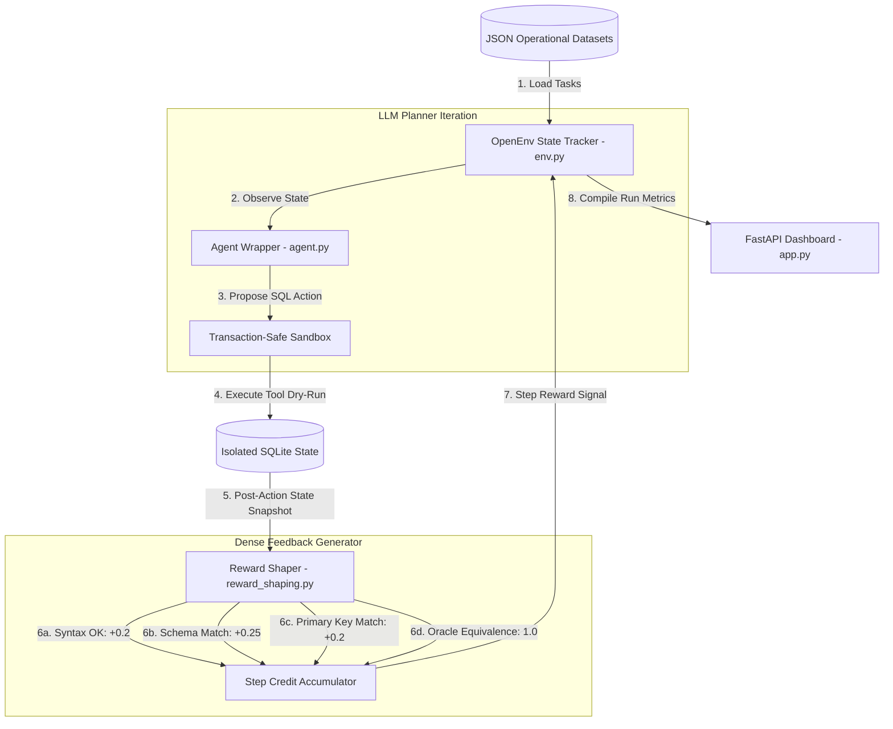

# CleanOps OpenEnv 🤖🧪 (Agent Evaluation & Reward Shaping Framework)

> **🚀 BENCHMARKS**: Scaffolds transaction-safe operational environments to evaluate LLM planners. Accelerates Reinforcement Learning alignment loops by mapping outcomes to a **dense step-level partial-credit reward function** instead of sparse binary scores.

CleanOps OpenEnv is an evaluation benchmark environment designed to score LLM agent planners on multi-step operational datasets (covering CRM, Billing, and Orders schemas).

---

## 💡 The "Why" vs. "How" (Systems Design Rationale)

*   **The Bottleneck (Why standard LLM evals fail)**: Traditional agent evaluation frameworks are black boxes that only evaluate the final output of an agent's run (sparse rewards). This makes it extremely difficult to train RL agents (like PPO or GRPO) because the policy receives no intermediate signal during a 10-step sequence, resulting in slow convergence. Additionally, running agent actions directly against database tables risks state corruption.
*   **The System-Level Solution (How we solved it)**: CleanOps executes agent tool actions inside an isolated, transaction-safe SQLite database state tracker. For each action, we intercept state changes and compute **dense reward shaping metrics** (granting partial credit: `0.2` for safe compilation, `+0.25` for table matches, `+0.2` for primary key alignments, up to `1.0` for target oracle match). This gives RL alignment pipelines high-fidelity feedback loops.

---

## 🏗️ OpenEnv Data Flow



---

## ⚡ Core Technical Features

1.  **Dense Reward Shaping Metric:**
    Calculates step-level progress rather than binary pass/fail outcomes, accelerating RL agent policy learning curves.
2.  **Transaction-Safe Execution Sandbox:**
    Spawns clean SQLite sessions for each evaluation loop. If an agent executes a destructive query, the state is rolled back cleanly to preserve database integrity.
3.  **FASTAPI Telemetry Portal:**
    Exposes a REST API (`/run-benchmark`, `/datasets`) to query live execution logs, agent token counts, execution latencies, and reward scoring trends.
4.  **Heuristic Fallback Engine:**
    If no OpenAI API key is present, the agent automatically falls back to a rule-based deterministic SQL parser to complete dry-run validation checks without throwing script errors.

---

## 📂 Project Structure

```
cleanops/
├── data/                   # JSON task datasets (CRM, Billing, Orders)
├── src/
│   ├── env.py              # OpenEnv execution environment & state tracker
│   ├── reward_shaping.py   # Dense step-level reward calculations
│   ├── agent.py            # LLM planning agent wrapper
│   ├── benchmark.py        # Benchmark evaluator loop
│   └── app.py              # FastAPI server backend
```

---

## 🚀 Quick Start (< 3 Minutes)

### 1. Install Dependencies
```bash
pip install -r requirements.txt
```

### 2. Configure Credentials
Create a `.env` file in the root directory:
```env
OPENAI_API_KEY=your_openai_api_key_here
```

### 3. Run Benchmark (CLI Mode)
Execute the evaluator locally to score LLM planning agent performance:
```bash
python3 -m src.benchmark
```

### 4. Start Telemetry Server (FastAPI)
```bash
uvicorn src.app:app --reload --host 127.0.0.1 --port 8000
# API documentation available at http://127.0.0.1:8000/docs
```
